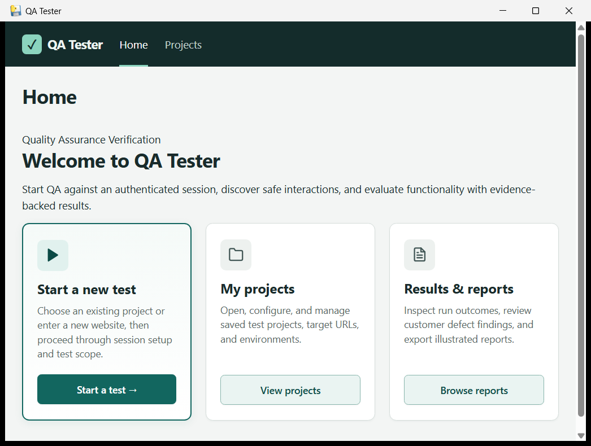
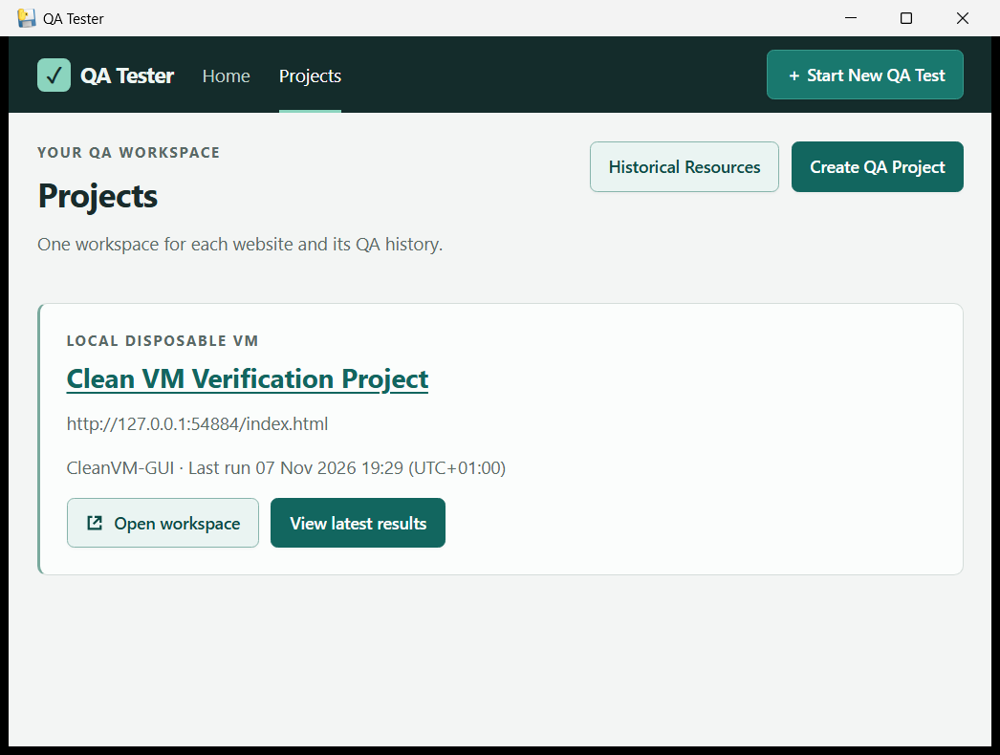
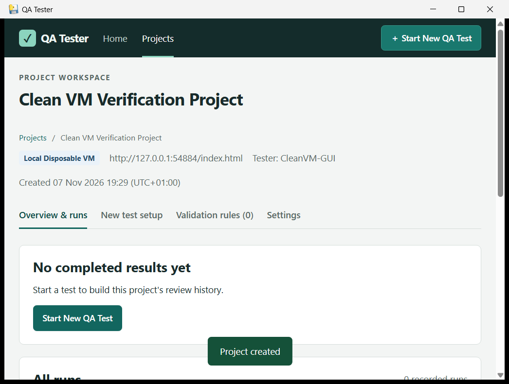
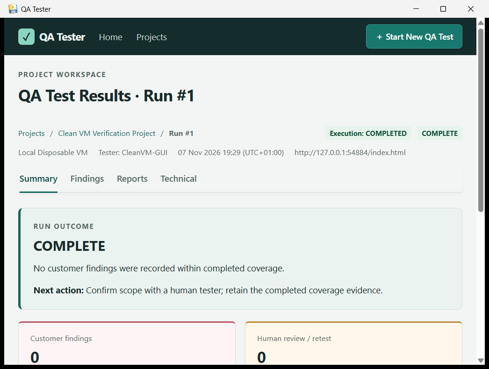

# QA Tester 1.0

**QA Tester** is a local-first Windows desktop application for structured, deterministic **functional web QA testing**. Built with Python, Flask, Playwright (Chromium), SQLite, and PyWebView (Edge WebView2), it helps a tester organize projects, run bounded browser checks across desktop and mobile viewports, review findings, and export clean client-ready reports in multiple formats.

> **Project Status:** Working personal Windows 1.0 desktop version (packaged with PyInstaller + custom Windows installer/uninstaller). This project is maintained for **personal use and IT portfolio demonstration** — it is **not** a security-certified or formally approved public software release.

---

## What QA Tester Does (and Does Not Do)

**QA Tester is built for functional QA:**
- Verifying that authorized web applications load cleanly, render across desktop (`1366×768`) and mobile (`390×844`) viewports, avoid broken same-origin links, and surface uncaught console/runtime errors with reproducible evidence.
- Supporting both automated bounded crawls and interactive headed Chromium sessions for manual exploration or authenticated flows.
- Separating private tester learning notes from external/customer-facing QA reports.

**QA Tester is NOT:**
- A penetration-testing tool, vulnerability scanner, or exploit framework (no SQLi, XSS, brute-forcing, or API fuzzing).
- A CAPTCHA solver or authentication bypass tool.

---

## Screenshots

Captured from the packaged Windows 11 native WebView2 desktop application using an isolated local verification project (no private project data):

### Home Dashboard


### Projects Workspace Overview


### Project Workspace & Setup


### Completed Run Results & Reporting Tabs


---

## Verified Features

The following capabilities have been verified in the packaged Windows 1.0 (`r14`) desktop build (and automated test suites):

- **Native Windows Desktop Shell:** PyWebView + Microsoft Edge WebView2 window backed by a local-only Flask HTTP server (`127.0.0.1:5000`), verifying WebView2 Runtime availability on startup and shutting down workers cleanly on window close.
- **Project & Run Lifecycle:** Create, view, edit, and organize QA projects with persistent SQLite storage (`qa-tester.db`) and isolated data directories via `QA_TESTER_WRITABLE_DIR`.
- **Automated Smart Smoke Crawl:** Bounded same-origin Playwright crawl (`chrome-headless-shell` / Chromium) checking desktop and mobile viewports, HTTP status errors (e.g., `404`), and uncaught JavaScript console exceptions.
- **Interactive Headed Browser Mode:** Launch a bundled Chromium session directly from a project workspace to navigate authenticated or complex UI flows before collecting evidence.
- **Structured Findings & Private Learning Notes:** Findings include severity, risk, confidence, review status, and private coaching/learning fields (`learning_explanation_sv`, `how_to_explain_sv`). Verified allowlist filtering ensures private learning notes appear only in the private finding view and are **excluded from every preview, copy payload, and exported report**.
- **Canonical Reporting & Multi-Format Export:**
  - **Report Modes:** Both **Standard** (concise customer-facing summary) and **Full Technical** (complete recorded checks and technical evidence) modes verified.
  - **In-App Preview:** Renders canonical HTML preview without creating export files on disk.
  - **Copy Report Payloads:** Generates plain-text and HTML report blocks for both Standard and Full Technical modes *(note: live OS clipboard button writing inside WebView2 was not automatically clicked in the isolated check and requires manual confirmation)*.
  - **File Exports:** Verified readable file generation for **Word (`.docx`)**, **Plain Text (`.txt`)**, **Markdown (`.md`)**, and **HTML (`.html`)** in both Standard and Full Technical modes.
- **Local API Guardrails:** Enforces `Host` header validation (DNS-rebinding protection), same-origin `Origin`/`Referer` or explicit `X-QA-Request` header checks on state-changing routes, and disabled-by-default shutdown endpoint.
- **Windows Packaging & Data Preservation:** Verified PyInstaller bundle + custom installer/uninstaller with long-path validation and byte-exact preservation of the user SQLite database across uninstall/reinstall and upgrade flows.

---

## Technical Stack & Architecture

| Layer | Technology |
|---|---|
| **Backend & Local API** | Python 3.12, Flask, Werkzeug (loopback `127.0.0.1:5000`) |
| **Browser Automation** | Playwright (bundled Chromium & Chrome Headless Shell) |
| **Desktop Interface** | PyWebView (Microsoft Edge WebView2 Runtime on Windows) |
| **Persistence** | SQLite (`%LOCALAPPDATA%\QATester\data\qa-tester.db` or `QA_TESTER_WRITABLE_DIR`) |
| **Reporting & Export** | Canonical read-only reporting model (`app/qa/reporting.py`) + renderers for HTML, Markdown, TXT, and Word (`python-docx`) |
| **Packaging** | PyInstaller (`QA-Tester.spec`), custom Windows Setup & Uninstall (`installer/`) |
| **Testing** | `pytest` unit, security, reporting, and packaging test suites (`tests/`) |

### Repository Layout

```text
QA-Tester/
├── desktop.py              # PyWebView desktop entry point & controlled server lifecycle
├── server.py               # Flask app initialization, security guards & blueprints
├── app/
│   ├── paths.py            # Packaged/dev path resolution & QA_TESTER_WRITABLE_DIR support
│   ├── security.py         # LocalHost / Origin / CSRF API guards
│   ├── data_lifecycle.py   # Mutation request lifecycle locking
│   ├── models/             # SQLite schema, crawl coverage & persistence helpers
│   ├── qa/                 # Smart Smoke engine, interactive mode, triage & report renderers
│   └── routes/             # Web views, REST API & multi-format export routes
├── templates/              # Jinja2 HTML views
├── static/                 # CSS & client-side reporting/UI logic
├── installer/              # Windows installer/uninstaller packaging scripts
├── docs/screenshots/       # Sanitized native Windows 11 desktop screenshots
├── tests/                  # Automated pytest suites
└── requirements.txt        # Python dependencies
```

---

## Running from Source (Development Mode)

### Prerequisites
- Python 3.12+ (Windows 10/11 recommended for the PyWebView/WebView2 desktop shell)
- Microsoft Edge WebView2 Runtime (preinstalled on Windows 11)

### Setup & Launch

```powershell
# 1. Clone the repository
git clone https://github.com/steva81/QA-Tester.git
cd QA-Tester

# 2. Create and activate a virtual environment
python -m venv venv
.\venv\Scripts\activate

# 3. Install Python dependencies and Playwright Chromium
pip install -r requirements.txt
playwright install chromium

# 4. Run the desktop application (PyWebView + Flask)
python desktop.py

# Or run the local web server only on http://127.0.0.1:5000
python server.py
```

### Running with an Isolated Data Directory

To test without touching your default `%LOCALAPPDATA%\QATester` directory, set `QA_TESTER_WRITABLE_DIR` before launching:

```powershell
$env:QA_TESTER_WRITABLE_DIR = "C:\Temp\QATester-Trial"
python desktop.py
```

### Running Automated Tests

```powershell
pytest tests/
```

---

## Known Limitations & Honest Scope Notes

- **Personal Windows Version, Not a Certified Public Release:** QA Tester 1.0 is built and verified for personal use and portfolio presentation. It is **not** code-signed for public distribution, and formal independent live-VM security sign-off for a public release was deliberately left uncompleted after transitioning focus to personal use.
- **Authorized Local / Same-Origin Testing Only:** Safe Mode restricts automated crawling to same-origin targets with bounded page/depth limits. Use only on websites you are authorized to test.
- **No Automated Login or CAPTCHA Bypass:** Automated headless crawls do not bypass authentication walls or CAPTCHAs; authenticated pages should be navigated manually in Interactive Browser mode.
- **Local Loopback Architecture (`127.0.0.1:5000`):** Designed as a single-user local desktop tool. Another local service using port `5000` can conflict unless `--port` or `QA_TESTER_PORT` is specified.
- **Platform Scope:** Core Flask/Playwright functionality is standard Python, while desktop shell integration (`WebView2`), packaging (`build_windows.ps1`), and installer tooling target Windows 10/11.
- **OS Clipboard Write in WebView2:** Automated verification confirmed all generated Standard/Full Technical copy payloads (plain text and HTML) exclude private notes and contain accurate findings, while clicking the in-window *Copy report* button to write to the Windows clipboard remains a manual UI check.
